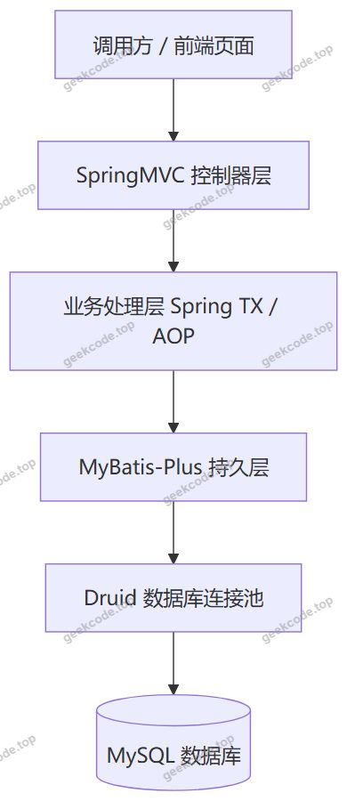
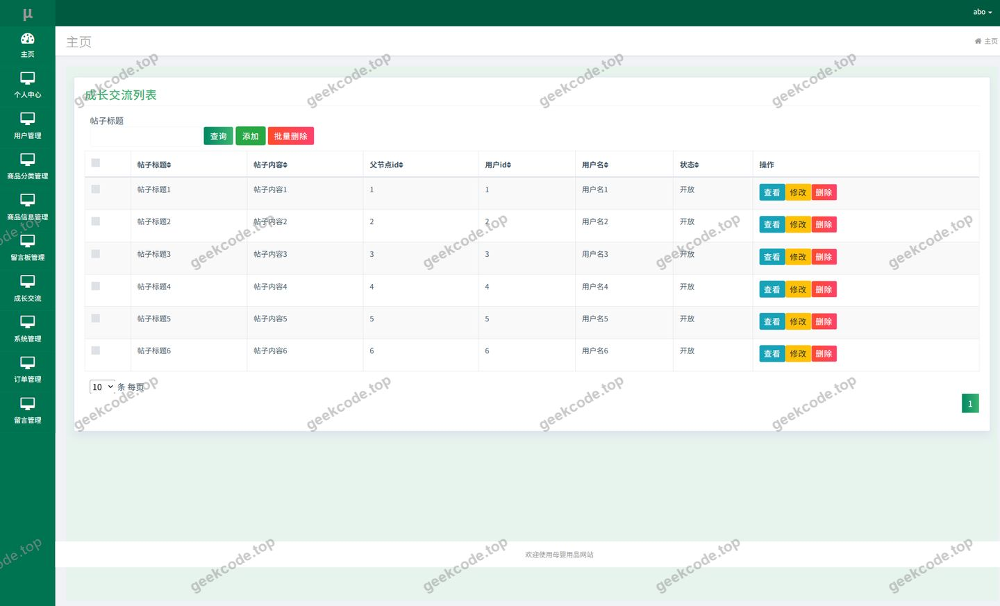
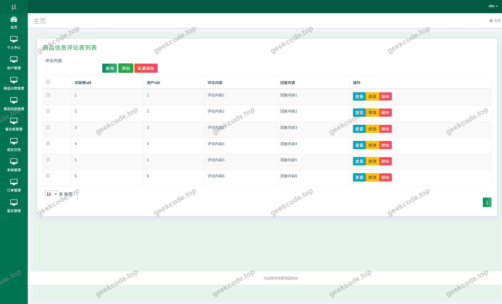
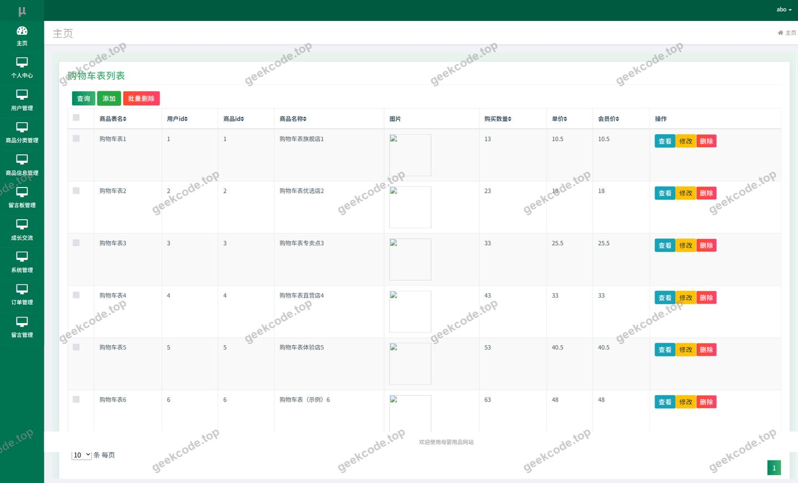
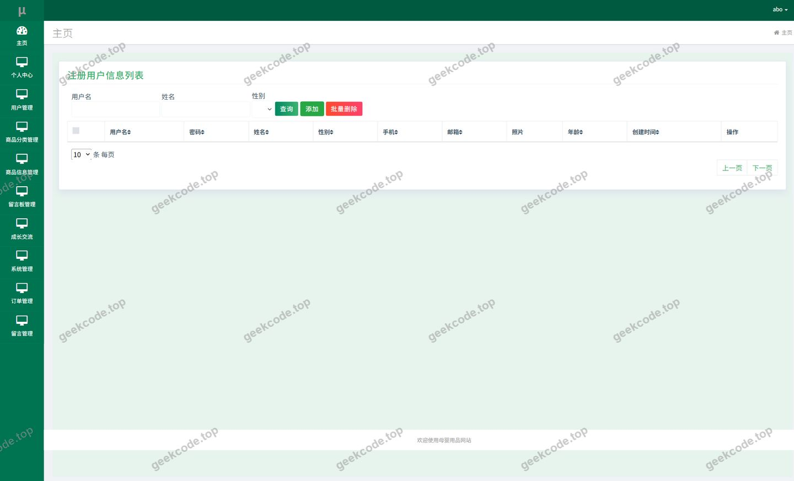
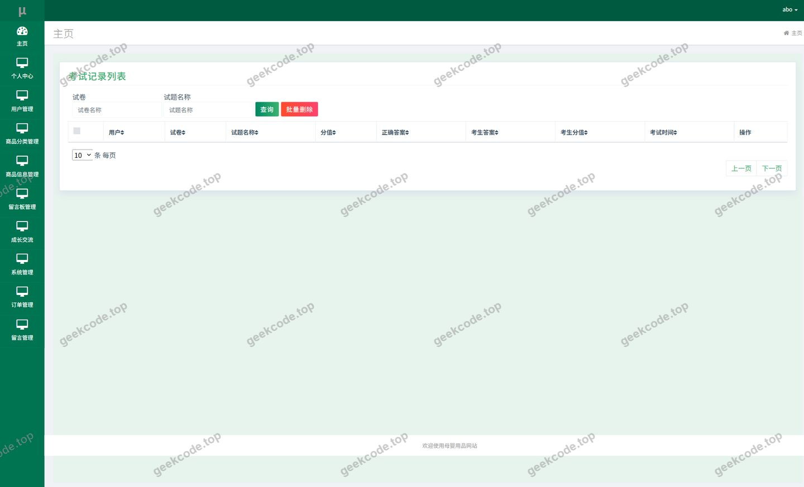
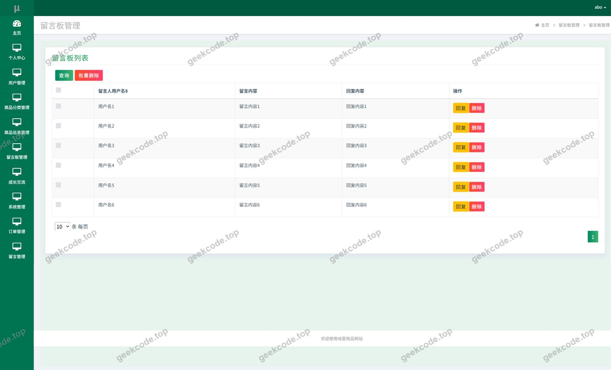
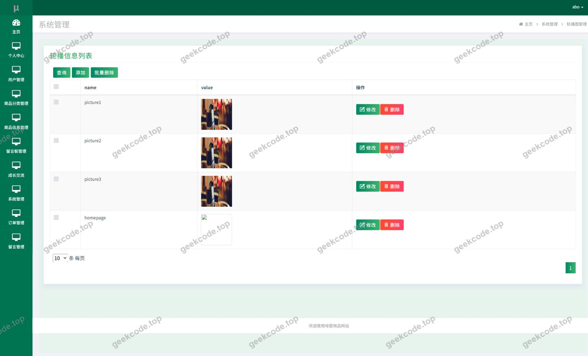
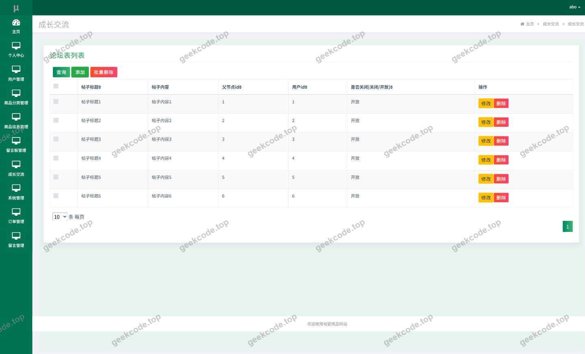

# java项目-ssm母婴用品网站-ssm毕业设计-带论文

> 🎓 **计算机毕业设计 · java项目-ssm母婴用品网站-ssm毕业设计-带论文**
>
> 本仓库只放**项目介绍 + 运行截图**（截图是站点带水印的原图，存在仓库 `images/` 里）。
>
> 👉 **完整可运行源码 / 数据库脚本 / 部署文档：[点我获取](https://geekcode.top/archives/java%E9%A1%B9%E7%9B%AE-ssm%E6%AF%8D%E5%A9%B4%E7%94%A8%E5%93%81%E7%BD%91%E7%AB%99-ssm%E6%AF%95%E4%B8%9A%E8%AE%BE%E8%AE%A1-%E5%B8%A6%E8%AE%BA%E6%96%87?utm_source=github)**
>
> 💬 咨询微信：**ir9372**　|　🌐 更多项目：[极客代码 geekcode.top](https://geekcode.top/?utm_source=github)
>
> 📌 项目详情页：<https://geekcode.top/archives/java%E9%A1%B9%E7%9B%AE-ssm%E6%AF%8D%E5%A9%B4%E7%94%A8%E5%93%81%E7%BD%91%E7%AB%99-ssm%E6%AF%95%E4%B8%9A%E8%AE%BE%E8%AE%A1-%E5%B8%A6%E8%AE%BA%E6%96%87?utm_source=github>

<table><td width="230" align="center"> <b>扫码加微信 ir9372</b></td><td valign="middle">📦 源码 = 项目介绍 + 全部运行截图 + 数据库 + 部署文档 👉 点上方任意截图，直接跳到 <b>极客代码 geekcode.top</b> 详情页</td></table>

---

<h1>java项目-ssm母婴用品网站-ssm毕业设计-带论文</h1>
<h2>项目概述</h2>

本项目为基于 SSM 架构的母婴用品网站，采用纯 API 服务形态（pure-api），后端使用 Spring + SpringMVC + MyBatis-Plus 构建，数据访问层由 Druid 连接池统一管理，对外以 HTTP 接口形式提供数据服务。系统面向母婴用品消费场景，围绕商品信息、论坛信息、新闻资讯、留言反馈四条前台业务主线展开，并配套个人中心功能，涵盖个人中心、我的发布、我的订单、我的地址、我的收藏等模块，实现从商品浏览、购物车、下单到地址维护与收藏管理的完整链路。系统同时提供用户管理、留言板管理、轮播图管理、论坛管理等运营侧页面，支撑平台日常内容维护与用户管理。适用人群为母婴用品消费者、平台运营与内容管理人员，以及作为课程设计、毕业设计参考的计算机专业学生。项目结构清晰、业务模块划分明确，适合作为中小型电商社区类系统的工程实践范例。

<h2>技术架构</h2>
<h3>整体架构</h3>

项目采用经典的三层分层架构，控制器层负责请求接收与参数校验，业务处理层由 Spring 容器统一托管并借助 Spring TX 与 Spring AOP 实现声明式事务与横切逻辑，持久层基于 MyBatis-Plus 完成对象与关系映射。项目类型为纯 API 服务，未包含独立部署的前端工程，接口输出的数据结构由前端页面或客户端调用方消费。

<h3>核心技术选型理由</h3>
<ul>
<li><strong>Spring Core / Context / Beans</strong>：作为整个应用的容器基础，负责 Bean 的装配与依赖注入，降低模块间耦合。</li>
<li><strong>SpringMVC（spring-web / spring-webmvc）</strong>：承担请求分发、参数绑定与响应序列化，是纯 API 服务对外暴露能力的核心组件。</li>
<li><strong>MyBatis-Plus</strong>：在 MyBatis 基础上提供通用 CRUD 能力与条件构造器，减少重复的映射文件编写，提升数据访问层的开发效率，同时保留自定义 SQL 的灵活性。</li>
<li><strong>Druid</strong>：作为数据库连接池，提供连接复用、连接有效性检测与 SQL 执行监控能力，便于在开发与运行阶段观察数据库访问状况。</li>
<li><strong>Spring TX / Spring AOP</strong>：为订单、库存等涉及多表写入的业务提供事务保障，并通过切面统一处理日志、事务等横切关注点。</li>
<li><strong>JUnit</strong>：提供单元测试支持，用于验证核心业务逻辑与数据访问逻辑。</li>
</ul>
<h3>数据库设计要点</h3>

依据控制器划分，系统数据模型大致围绕以下业务实体组织：用户、商品信息、商品分类、商品信息评论、订单、购物车、收货地址、收藏、论坛信息、新闻资讯、留言反馈、系统配置。其中商品信息与商品分类之间构成分类归属关系，商品信息评论与商品信息、用户构成多对多语义的评论关联；订单与用户、地址、商品之间存在关联关系，购物车记录了用户与商品的临时关联；收藏记录用户与商品的长期关联；论坛信息与用户之间存在发布关系，对应&quot;我的发布&quot;入口。具体表结构与字段定义根据现有信息无法确定。

<h2>功能模块</h2>
<h3>前台用户端</h3>
<ul>
<li><strong>用户与登录</strong>：提供用户注册与登录入口，登录后进入个人中心，是订单、收藏、地址等个性化功能的前置条件，对应截图中的&quot;页面-登录&quot;与&quot;页面-用户&quot;。</li>
<li><strong>商品信息</strong>：展示商品列表与商品详情，支持按商品分类浏览，由商品信息控制器与商品分类控制器对接数据。</li>
<li><strong>商品信息评论</strong>：用户可对商品发表评论，评论数据与商品、用户关联，对应&quot;页面-商品信息评论&quot;。</li>
<li><strong>购物车</strong>：记录用户拟购买的商品，支持添加、查看、调整与结算前的统一管理。</li>
<li><strong>我的订单</strong>：展示用户的历史订单与订单明细，支持订单状态查看。</li>
<li><strong>我的地址</strong>：维护用户的收货地址信息，作为下单流程的基础数据。</li>
<li><strong>我的收藏</strong>：记录用户收藏的商品，提供收藏列表查看与取消收藏能力。</li>
<li><strong>论坛信息与我的发布</strong>：提供论坛帖子的浏览与发布能力，&quot;我的发布&quot;用于集中查看当前用户已发布的内容，对应&quot;页面-成长交流&quot;。</li>
<li><strong>新闻资讯</strong>：展示平台发布的新闻与资讯内容，属于内容运营板块。</li>
<li><strong>留言反馈</strong>：用户提交留言与反馈意见，由留言控制器统一处理。</li>
<li><strong>文件接口</strong>：提供文件上传等通用文件处理能力，供商品图片、头像、帖子配图等场景调用。</li>
</ul>
<h3>后台管理端</h3>

项目未配置独立的后台路由，管理类功能与前台功能共用同一套控制器接口对外提供服务，管理端页面通过调用相同接口完成数据管理。依据截图列表，管理侧涉及以下页面：用户管理（页面-用户、页面-defaultuser）、留言板管理（页面-liuyanbanguanli）、轮播图管理（页面-lunbotuguanli）、论坛管理（页面-luntanguanli），以及商品信息评论管理、成长交流等页面。上述管理页面的具体菜单层级与请求路径根据现有信息无法确定。

<h2>用户角色与权限</h2>

系统包含两类角色，具体划分如下。

<h3>普通用户</h3>
<ul>
<li><strong>商品信息</strong>：浏览商品列表与商品详情，按分类筛选商品。</li>
<li><strong>商品信息评论</strong>：查看并对商品发表评论。</li>
<li><strong>购物车</strong>：添加商品至购物车、查看购物车内容、调整购物车记录。</li>
<li><strong>我的订单</strong>：查看本人订单记录。</li>
<li><strong>我的地址</strong>：新增、修改、删除本人收货地址。</li>
<li><strong>我的收藏</strong>：收藏商品、查看收藏列表、取消收藏。</li>
<li><strong>论坛信息</strong>：浏览论坛帖子、参与讨论。</li>
<li><strong>我的发布</strong>：查看与管理本人发布的内容。</li>
<li><strong>新闻资讯</strong>：浏览平台新闻与资讯。</li>
<li><strong>留言反馈</strong>：提交留言与反馈。</li>
<li><strong>个人中心</strong>：查看与维护本人账号信息。</li>
</ul>
<h3>管理员</h3>
<ul>
<li><strong>用户管理</strong>：查看与维护平台用户信息，对应&quot;页面-用户&quot;、&quot;页面-defaultuser&quot;。</li>
<li><strong>留言板管理</strong>：查看与处理用户提交的留言，对应&quot;页面-liuyanbanguanli&quot;。</li>
<li><strong>轮播图管理</strong>：维护首页轮播图内容，对应&quot;页面-lunbotuguanli&quot;。</li>
<li><strong>论坛管理</strong>：管理论坛帖子内容，对应&quot;页面-luntanguanli&quot;。</li>
<li><strong>商品信息与评论管理</strong>：维护商品信息、商品分类及商品评论内容，对应&quot;页面-商品信息评论&quot;。</li>
<li><strong>成长交流内容管理</strong>：维护成长交流板块内容，对应&quot;页面-成长交流&quot;。</li>
<li><strong>考试记录相关页面</strong>：截图中存在&quot;页面-kaoshijilu&quot;，该页面与母婴用品网站的主业务线无直接对应关系，其功能归属与具体权限根据现有信息无法确定。</li>
</ul>
<h2>项目特色与创新点</h2>
<ul>
<li><strong>业务场景完整闭环</strong>：系统将商品浏览、购物车、订单、地址、收藏串联为一条完整的消费链路，用户从浏览商品到完成下单所需的环节在同一系统内闭环完成。</li>
<li><strong>电商与社区内容融合</strong>：在商品交易能力之外，集成论坛信息、新闻资讯、成长交流与留言反馈模块，使平台同时具备内容沉淀与用户互动能力，适合母婴类目下用户对经验交流与信息获取的强需求特征。</li>
<li><strong>纯 API 服务形态</strong>：项目以接口为核心组织代码，控制器职责边界清晰，便于对接多种调用方，也便于在后续演进中替换或新增前端展示层。</li>
<li><strong>持久层开发效率优化</strong>：引入 MyBatis-Plus 承担通用增删改查与条件查询，使开发者可将精力集中在业务逻辑与复杂查询上。</li>
<li><strong>数据库访问可观测性</strong>：通过 Druid 连接池统一管理数据库连接，提供连接与 SQL 层面的运行状态观察能力，有利于排查性能问题与连接泄漏隐患。</li>
<li><strong>事务与切面统一治理</strong>：依托 Spring TX 与 Spring AOP，将事务控制与横切逻辑从业务代码中剥离，提升代码的可维护性与一致性。</li>
</ul>
<h2>部署环境</h2>
<h3>运行环境</h3>
<ul>
<li><strong>JDK</strong>：项目为 Java 工程，需安装 JDK 并配置 JAVA_HOME；具体版本号根据现有信息无法确定。</li>
<li><strong>构建工具</strong>：Maven，用于依赖管理与项目构建打包。</li>
<li><strong>Web 容器</strong>：需支持 Servlet 规范的容器以承载 SpringMVC 应用；具体容器类型根据现有信息无法确定。</li>
<li><strong>MySQL</strong>：关系型数据库，用于存储用户、商品、订单、论坛、新闻资讯、留言等业务数据，具体版本根据现有信息无法确定。</li>
</ul>
<h3>依赖组件</h3>
<ul>
<li><strong>Spring 系列组件</strong>：spring-core、spring-context、spring-context-support、spring-beans、spring-aop、spring-jdbc、spring-tx、spring-web、spring-webmvc。</li>
<li><strong>持久层组件</strong>：MyBatis-Plus。</li>
<li><strong>连接池组件</strong>：Druid。</li>
<li><strong>测试组件</strong>：JUnit。</li>
</ul>
<h3>不适用环境</h3>

本项目为纯 API 后端服务，未包含独立前端工程与小程序端，因此 Node.js 运行环境与微信开发者工具不属于本项目的部署依赖。

<h2>五、技术特性</h2>
<ul>
<li>使用 MyBatis-Plus 简化数据访问层开发</li>
</ul>
<h2>六、功能模块截图</h2>
<h3>后台管理端</h3>
<h4>页面-成长交流</h4>

<h4>页面-登录</h4>

<h4>页面-商品信息评论</h4>

<h4>页面-用户</h4>

<h4>页面-defaultuser</h4>

<h4>页面-kaoshijilu</h4>

<h4>页面-liuyanbanguanli</h4>

<h4>页面-lunbotuguanli</h4>

<h4>页面-luntanguanli</h4>

---

## 获取完整源码

| 项目 | 说明 |
| --- | --- |
| 项目名 | java项目-ssm母婴用品网站-ssm毕业设计-带论文 |
| 运行截图 | 本文 10 张（站点带水印原图，仓库 `images/` 目录） |
| 完整源码 | [https://geekcode.top/archives/java%E9%A1%B9%E7%9B%AE-ssm%E6%AF%8D%E5%A9%B4%E7%94%A8%E5%93%81%E7%BD%91%E7%AB%99-ssm%E6%AF%95%E4%B8%9A%E8%AE%BE%E8%AE%A1-%E5%B8%A6%E8%AE%BA%E6%96%87?utm_source=github](https://geekcode.top/archives/java%E9%A1%B9%E7%9B%AE-ssm%E6%AF%8D%E5%A9%B4%E7%94%A8%E5%93%81%E7%BD%91%E7%AB%99-ssm%E6%AF%95%E4%B8%9A%E8%AE%BE%E8%AE%A1-%E5%B8%A6%E8%AE%BA%E6%96%87?utm_source=github) |
| 咨询微信 | **ir9372**（备注：jingpin-yuanma） |
| 更多项目 | [极客代码 geekcode.top](https://geekcode.top/?utm_source=github) |

> 需要源码、部署、改配置、跑不起来等问题，加微信 ir9372 沟通，说明项目名即可。
